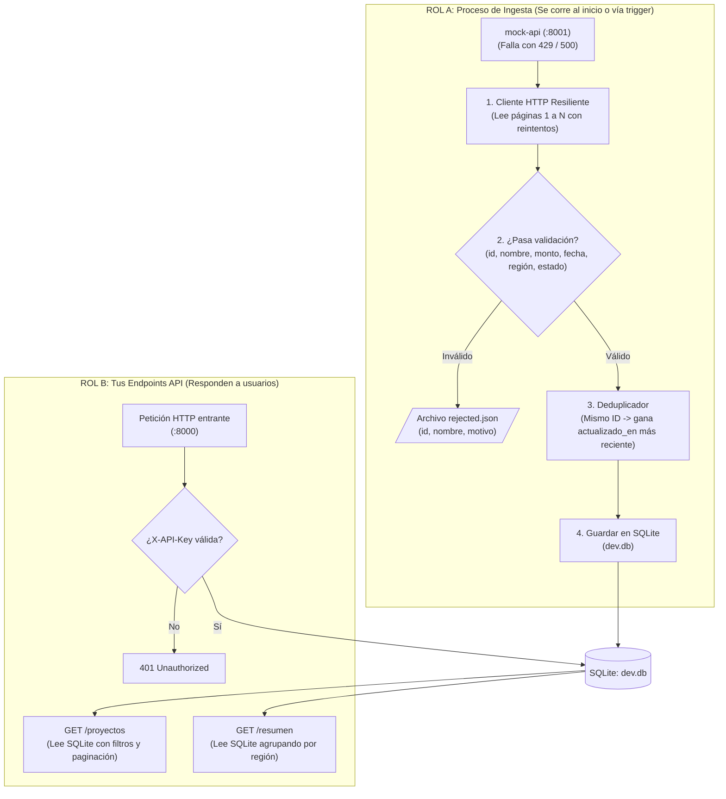

# 📋 Roadmap & Plan de Trabajo – Prueba Técnica CBC

> **Aclaración fundamental de Arquitectura:**  
> **¿Dónde se limpian los datos?**  
> ❌ **NO se limpian dentro de `GET /proyectos` ni en `GET /resumen`.** Si limpiaras los datos cuando un usuario consulta la API, tendrías que llamar en ese mismo instante a la fuente externa (que es lenta y falla con 429/500), haciendo la API lenta y propensa a caídas.  
> ✅ **Se limpian ANTES, en un proceso previo llamado "Ingesta" (ETL).**  
> Tu aplicación tiene **dos roles separados**:
> 1. **Proceso de Ingesta (Segundo plano / Al arrancar):** Va a buscar los datos a la `mock-api`, los limpia, guarda los inválidos en `rejected.json` y guarda los válidos en tu base de datos SQLite.
> 2. **Servidor API (Tus endpoints):** Cuando alguien llama a `GET /proyectos` o `GET /resumen`, tu API **únicamente consulta tu SQLite local** (donde todo ya está 100% limpio y sin duplicados) y responde al instante.

---

## 🧭 Los Dos Roles de tu Aplicación (Separación Clara)

```
┌────────────────────────────────────────────────────────────────────────────────────────┐
│ ROL A: PROCESO DE INGESTA (ETL)                                                        │
│ Se ejecuta al arrancar el contenedor o mediante un comando/trigger.                   │
│                                                                                        │
│ 1. Cliente HTTP      ──> Consume las páginas de mock-api (con reintentos 429 y 500).  │
│ 2. Normalizador      ──> Limpia fechas, montos, regiones, estados.                    │
│ 3. Rechazos          ──> Si un registro es inválido, lo escribe en rejected.json.      │
│ 4. Deduplicador      ──> Si hay IDs repetidos, conserva el más reciente.               │
│ 5. Guardado          ──> Inserta o actualiza los proyectos limpios en SQLite.          │
└──────────────────────────────────────────┬─────────────────────────────────────────────┘
                                           │
                                           ▼ Guarda datos limpios
                                  [( Base de Datos SQLite )]
                                           ▲
                                           │ Solo lee de aquí
┌──────────────────────────────────────────┴─────────────────────────────────────────────┐
│ ROL B: SERVIDOR API REST                                                               │
│ Responde a los clientes/evaluadores que consultan tu servicio.                         │
│                                                                                        │
│ 1. Guardia de Seguridad ──> Valida la cabecera X-API-Key (401 si falla).               │
│ 2. GET /proyectos       ──> Lee de SQLite, filtra por región/estado/monto y pagina.    │
│ 3. GET /resumen         ──> Lee de SQLite, agrupa y suma montos por región.            │
└────────────────────────────────────────────────────────────────────────────────────────┘
```

---

## 🗺️ Diagrama del Flujo Completo



---

## 🧩 ¿Qué componentes de código programas exactamente?

| Archivo / Componente | Qué hace | ¿En qué momento se usa? |
| :--- | :--- | :--- |
| **1. Módulo Normalizador (`cleaner.ts`)** | Funciones puras que reciben un registro sucio de texto y devuelven el dato tipado/limpio o el código de rechazo (`fecha_invalida`, `monto_invalido`, etc.). | Usado en la Ingesta. |
| **2. Cliente Ingesta (`ingestion.service.ts`)** | Llama a `mock-api` con reintentos $\rightarrow$ llama al normalizador $\rightarrow$ genera `rejected.json` $\rightarrow$ guarda en SQLite. | Al iniciar el servidor o por comando. |
| **3. Controlador API (`projects.controller.ts`)** | Expone `GET /proyectos` y `GET /resumen` leyendo directamente de SQLite. | Cada vez que un usuario hace una petición. |
| **4. Guard de Autenticación (`api-key.guard.ts`)** | Compara el header `X-API-Key` contra la variable de entorno `API_KEY`. | En cada petición a la API. |

---

## 📌 Checklist Detallado por Etapas

### ✅ Etapa 0: Entorno y Setup Base (Listo)
- [x] **0.1. Mock API levantada:** Verificada con Docker en puerto 8001.
- [x] **0.2. Backend inicializado:** Creado con NestJS + TypeScript en `app/`.
- [x] **0.3. Base de Datos configurada:** Prisma ORM con modelo `Project` y SQLite listo.
- [x] **0.4. Docker compose configurado:** Ambos servicios integrados con volumen para persistencia.

---

### ⏳ Etapa 1: Funciones de Limpieza y Normalización (Lógica Pura)
> **Objetivo:** Escribir funciones que reciban el texto crudo y devuelvan el objeto limpio o lancen el motivo de rechazo exacto exigido por `CONTRATO.md`.

- [x] **1.1. Limpiador de ID y Nombres:**
  - `id`: Quitar espacios y pasar a mayúsculas (`P-0042`). Si queda vacío $\rightarrow$ rechazo `id_vacio`.
  - `nombre`: Trim y quitar espacios dobles interiores. Si queda vacío $\rightarrow$ rechazo `nombre_vacio`.
  - `titular`: Trim de espacios (puede quedar vacío, no rechaza).
- [x] **1.2. Conversor de Montos a Millones USD (`monto_musd`):**
  - `1.234,5 MM USD` $\rightarrow$ `1234.5`
  - `US$ 2,5 millones` $\rightarrow$ `2.5`
  - `850000` (sin unidad = dólares enteros) $\rightarrow$ `0.85`
  - No numérico $\rightarrow$ `monto_invalido`. Si es $\le 0$ $\rightarrow$ `monto_negativo`.
  - Guardar con máximo 3 decimales.
- [x] **1.3. Conversor de Fechas a ISO (`AAAA-MM-DD`):**
  - Formatos aceptados: `AAAA-MM-DD`, `DD/MM/AAAA` y `DD-mmm-AAAA` (meses en español: `ene`, `feb`, etc.).
  - Fecha inexistente (ej. `31/02/2024`) $\rightarrow$ `fecha_invalida`.
- [x] **1.4. Mapeador de Regiones:**
  - Convierte variantes (romanos como `II Región` o `Región de Antofagasta`) al nombre oficial (`Antofagasta`).
  - Si no existe en la lista oficial $\rightarrow$ `region_desconocida`.
- [x] **1.5. Mapeador de Estados:**
  - Unifica a `En evaluación`, `Aprobado` o `Rechazado` (insensible a mayúsculas y tildes).
  - Cualquier otro valor $\rightarrow$ `estado_desconocido`.
- [x] **1.6. Deduplicación y Escritor de Rechazos:**
  - Misma ID: conservar únicamente el que tenga `actualizado_en` más reciente (los duplicados no son rechazados).
  - Escribir registros inválidos en `rejected.json` con `{ id, nombre, motivo }`.
- [x] **1.7. Tests Unitarios:**
  - Probar con Vitest todos los casos borde de fechas, montos, estados, regiones, deduplicación y escritura de archivo.

---

### ⏳ Etapa 2: Proceso de Ingesta (El pipeline ETL)
> **Objetivo:** El proceso que se conecta a la `mock-api`, maneja los errores de red, aplica la limpieza y guarda en SQLite.

- [ ] **2.1. Cliente HTTP con reintentos:**
  - Consultar paginado desde `page=1` hasta `total_pages`.
  - Ante error `429`: leer cabecera `Retry-After` y pausar los segundos requeridos antes de reintentar.
  - Ante error `500`: aplicar reintentos con backoff exponencial.
- [ ] **2.2. Guardado Idempotente:**
  - Persistir los proyectos limpios en SQLite.
  - Asegurar que ejecutar la ingesta 2 o más veces seguidas deje la base de datos exactamente igual (sin registros duplicados).
- [ ] **2.3. Disparador de Ingesta:**
  - Configurar que la ingesta se ejecute automáticamente al levantar el servicio (onModuleInit) o mediante un comando/endpoint.

---

### ⏳ Etapa 3: Endpoints de la API REST
> **Objetivo:** Exponer los datos ya limpios desde SQLite hacia el exterior.

- [ ] **3.1. Autenticación (`X-API-Key`):**
  - Validar cabecera contra la variable de entorno `API_KEY`. Responder `401` si no coincide.
- [ ] **3.2. Endpoint `GET /proyectos`:**
  - Consulta únicamente sobre la base de datos SQLite.
  - Filtros opcionales: `region`, `estado`, `monto_min`.
  - Paginación: `page` (default 1), `page_size` (default 20, max 100).
  - Orden: Siempre por `id` ascendente.
  - Si mandan parámetros inválidos (ej. `monto_min=abc`) $\rightarrow$ responder `400 Bad Request`.
  - Estructura exacta de respuesta: `{ items: [...], total, page, page_size }`.
- [ ] **3.3. Endpoint `GET /resumen`:**
  - Retornar agrupado por región: `[{ region: "Antofagasta", cantidad: 14, monto_total_musd: 3926.07 }, ...]`.
- [ ] **3.4. Tests de integración:**
  - Probar peticiones HTTP a los endpoints comprobando filtros, respuestas 200, 400 y 401.

---

### ⏳ Etapa 4: Documentación y Entrega Final
- [x] **4.1. `DISENO.md` (Parte 2):** Respuestas de diseño y trade-offs listas.
- [ ] **4.2. `README.md` (Parte 1):**
  - Comandos para levantar (`docker compose up --build`).
  - Variables de entorno, puertos y claves de prueba.
  - Explicar cómo corre la ingesta y dónde queda `rejected.json`.
  - Justificación de SQLite, supuestos y mención de herramientas de IA.
- [ ] **4.3. Entrega en GitHub:**
  - Dar permisos de lectura a `doyarce@cbc.cl` y `gleal@cbc.cl`.
